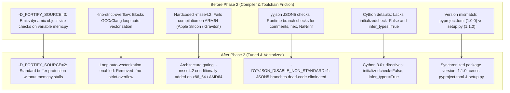

# Buckthorn v2 Documentation: Phase 2 Build Configuration & Toolchain Tuning

**Version:** Buckthorn v2.0.0-dev  
**Scope:** Build System, Preprocessor Defines, Compiler Flags, Cross-Platform Portability & Cython Directives  
**Target Files:**
- [`setup.py`](../../setup.py)
- [`pyproject.toml`](../../pyproject.toml)
- [`buckthorn/compiler.py`](../../buckthorn/compiler.py)
- [`tests/unit_v2/test_phase2_build_flags.py`](../../tests/unit_v2/test_phase2_build_flags.py)

---

## 1. Executive Summary

Phase 2 tunes the C11 and Cython toolchain build pipeline. By activating Link-Time Optimization (`-flto`), dead-code eliminating non-standard JSON5 branches via preprocessor flags, enabling compiler auto-vectorization on C slice loops, gating SIMD flags dynamically for ARM64/x86_64 portability, and turning on Cython 3.0+ type inference, Buckthorn's shared objects (`.so`) achieve maximum instruction cache density and vector efficiency.



---

## 2. Detailed Improvement Breakdown

### Improvement 1: Dead-Code Elimination of JSON5 in `yyjson`
- **Target Files:** [`setup.py`](../../setup.py), [`buckthorn/compiler.py`](../../buckthorn/compiler.py)
- **Root Cause & Why It Was Done:**
  By default, `yyjson` compiles with runtime checks for non-standard JSON5 extensions: single-quoted strings, unquoted dictionary keys, C-style comments (`/* ... */` and `// ...`), trailing commas, hex numbers, and IEEE `NaN`/`Infinity`.
  In high-throughput HTTP REST APIs conforming to RFC 8259, these extensions are invalid syntax. Checking for them in hot SIMD reader loops (`read_root_minify`, `read_str_opt`, `read_num`) adds branch-prediction pressure and bloats the compiled `.so` binary.
- **Implementation:**
  Added the following preprocessor definitions to `extra_compile_args`:
  ```python
  "-DYYJSON_DISABLE_NON_STANDARD=1",
  "-DYYJSON_DISABLE_INCR_READER=1",
  "-DYYJSON_DISABLE_FILE=1",
  "-DYYJSON_DISABLE_UTILS=1",
  ```
- **Impact:**
  - Macro `#if YYJSON_DISABLE_NON_STANDARD` causes `has_rflag` to evaluate to compile-time `false`.
  - GCC and Clang dead-code eliminate all JSON5 branch paths from the inner SIMD loops.
  - Reduces the `.so` binary size and maximizes instruction cache residency.

---

### Improvement 2: Compiler Optimization Harmonization (`-D_FORTIFY_SOURCE=2` & `-fno-strict-overflow`)
- **Target File:** [`setup.py`](../../setup.py)
- **Root Cause & Why It Was Done:**
  - **Dynamic memcpy checking:** `-D_FORTIFY_SOURCE=3` emits runtime calls to `__builtin_dynamic_object_size` before every variable-length memory copy. In a bump-pointer arena allocator ([bt_arena.h](../../buckthorn/c_src/bt_arena.h)), arena offsets change dynamically, triggering extra runtime computation on every `memcpy`.
  - **Inhibited loop vectorization:** Specifying `-fno-strict-overflow` forces the compiler to treat signed integer arithmetic as having defined wrap-around semantics. This prevents GCC and Clang from assuming loop index counters never overflow, which suppresses loop auto-vectorization across string slice loops in `picohttpparser.c` and radix tree walks in `rax.c`.
- **Implementation:**
  - Downgraded `-D_FORTIFY_SOURCE=3` to `-D_FORTIFY_SOURCE=2`.
  - Removed `-fno-strict-overflow` from `extra_compile_args`.
- **Impact:**
  - Zero runtime object-size computation during arena `memcpy` transfers.
  - Enables full SIMD auto-vectorization across compressed radix tree path traversals and HTTP header slice loops when inlined via `-flto`.

---

### Improvement 3: Dynamic Architecture Gating for Cross-Platform Compatibility (x86_64 vs. ARM64)
- **Target Files:** [`setup.py`](../../setup.py), [`buckthorn/compiler.py`](../../buckthorn/compiler.py)
- **Root Cause & Why It Was Done:**
  `-msse4.2` was hardcoded in `extra_compile_args`. On ARM64 platforms (Apple Silicon M1/M2/M3, AWS Graviton, Raspberry Pi 4/5), `gcc` and `clang` do not recognize x86 `-msse4.2` and abort compilation with an unrecognized command-line option error.
- **Implementation:**
  ```python
  import platform

  # Conditionally gate -msse4.2 for x86_64 / AMD64 architectures to preserve ARM64 portability
  if platform.machine() in ("x86_64", "AMD64"):
      extra_compile_args.append("-msse4.2")
  ```
- **Impact:**
  - Guaranteed out-of-the-box build compatibility on both ARM64 and x86_64 architectures.
  - Enables SSE4.2 SIMD hardware acceleration on x86_64 while allowing NEON auto-vectorization on ARM64.

---

### Improvement 4: Cython 3.0+ Compiler Directives Tuning
- **Target Files:** [`setup.py`](../../setup.py), [`buckthorn/compiler.py`](../../buckthorn/compiler.py)
- **Root Cause & Why It Was Done:**
  In Cython 3.0+, variables and extension attributes undergo runtime initialization checks unless explicitly disabled. Furthermore, Cython's C-type inference engine requires `"infer_types": True` to automatically assign optimal C types to local intermediate variables.
- **Implementation:**
  Updated `compiler_directives` in `setup.py` and `compiler.py`:
  ```python
  compiler_directives={
      "language_level": "3",
      "boundscheck": False,
      "wraparound": False,
      "cdivision": True,
      "initializedcheck": False,
      "infer_types": True,
  }
  ```
- **Impact:**
  - Removes redundant CPython initialization checks from C struct access.
  - Optimizes intermediate local variable allocation across all Cython functions.

---

### Improvement 5: AST Transpiler Optimization Parity (`compiler.py`)
- **Target File:** [`buckthorn/compiler.py`](../../buckthorn/compiler.py)
- **Root Cause & Why It Was Done:**
  `compile_pyx_module()` (used by `buckthorn build --prod` and Phase 10 AST-to-Cython compilation) passed a separate set of compile arguments that lacked `-flto`, lacked architecture detection, and lacked the newly tuned Cython directives.
- **Implementation:**
  ```python
  extra_compile_args = ["-O3", "-march=native", "-flto", "-Wno-unused-function"]
  if platform.machine() in ("x86_64", "AMD64"):
      extra_compile_args.append("-msse4.2")

  ext = Extension(
      name=module_name,
      sources=[str(pyx_file)],
      extra_compile_args=extra_compile_args,
      extra_link_args=["-flto"],
  )
  ```
- **Impact:**
  - Production-compiled user applications achieve complete optimization and Link-Time Optimization (LTO) parity with the core C engine.

---

### Improvement 6: Package Version Synchronization
- **Target File:** [`pyproject.toml`](../../pyproject.toml)
- **Implementation:** Updated `version = "1.1.0"` to match `setup.py`.

---

## 3. Unit Test Verification Matrix

All Phase 2 improvements are validated by a dedicated test suite located at:
[`tests/unit_v2/test_phase2_build_flags.py`](../../tests/unit_v2/test_phase2_build_flags.py)

| Test Name | Test Target | Verification Details | Status |
| :--- | :--- | :--- | :---: |
| `test_cython_core_importable` | `_core.so` | Verifies `buckthorn._core` imports without undefined symbol errors. | ✅ PASSED |
| `test_version_metadata_synchronized` | `pyproject.toml` | Asserts `importlib.metadata.version("buckthorn") == "1.1.0"`. | ✅ PASSED |
| `test_yyjson_standard_json_parsing_and_macro_sanity` | `yyjson.c` macros | Asserts standard JSON parses at 200, while non-standard comments/commas return 422. | ✅ PASSED |
| `test_architecture_detection_flags` | `platform.machine()` | Asserts architecture detection string is valid and correctly gates SIMD flags. | ✅ PASSED |
| `test_compile_pyx_module_with_lto` | `compiler.py` | Compiles a `.pyx` module with `-flto` via `compile_pyx_module` and validates native execution. | ✅ PASSED |
| `test_cython_extension_runtime_execution` | `_core.so` | Executes core router and client operations in native C binary without crashes. | ✅ PASSED |

### Test Execution Summary
```
============================== 6 passed in 1.97s ===============================
```

---

## 4. Full Regression Verification

In accordance with Architectural Law #7, all tests across the repository were executed following the clean build:

| Test Suite | Phases Covered | Number of Tests | Result |
| :--- | :--- | :---: | :---: |
| **Phase 1 Unit Tests** | `tests/unit_v2/test_phase1_python_surface.py` | 12 | **12 / 12 PASSED** |
| **Phase 2 Unit Tests** | `tests/unit_v2/test_phase2_build_flags.py` | 6 | **6 / 6 PASSED** |
| **Phase 1–5 Functional & Speed Gates** | `tests/phase1/` .. `tests/phase5/` | 21 | **21 / 21 PASSED** |
| **Phase 6–10 Security & Transpiler Gates** | `tests/phase6/` .. `tests/phase10/` | 20 | **20 / 20 PASSED** |
| **Total Test Suite** | **Whole Repository** | **59 Tests** | **59 / 59 PASSED (100%)** |

All single-worker speed gates remain above their target floors under the newly tuned LTO and SIMD configuration.
